# stinux-dawin-bash

StinuxOS (Debian 12 bookworm) avec la couche bash multiplateforme [linux-dawin-bash](https://github.com/Leo-76/linux-dawin-bash) integree.

## Pourquoi ce depot

Pivot depuis le projet [PureDarwin/XNU](https://github.com/Leo-76/BASH-BUILD-OSX) : le kernel Darwin reste bloque juste apres le handoff EFI->kernel dans QEMU. Plutot que de continuer a deboguer un noyau XNU sur du materiel generique, ce depot repart d'une base Linux qui boote de maniere fiable (StinuxOS Server v5) et y ajoute la couche bash multiplateforme.

## Contenu

- Base : StinuxOS Server v5 (Debian 12 bookworm, kernel 6.1.0-53-amd64, live-build)
- Ajout : `/opt/linux-dawin-bash/` (bash.linux-x86_64, bash.darwin-x86_64, lanceur `bash`)
- Wrapper : `/usr/local/bin/dawin-bash` accessible depuis le PATH

## Important : perimetre reel

Cette couche ne fournit **que bash** (meme source bash 5.3p9, deux binaires : ELF pour Linux, Mach-O pour Darwin/PureDarwin, choisis par un lanceur selon `uname`). Les autres commandes (`sed`, `stat`, `tar`, etc.) restent celles de Debian/GNU-Linux : ce n'est pas une couche de compatibilite complete des commandes macOS.

### Le binaire Mach-O ne s'execute pas sur Linux (attendu)

Executer directement `bash.darwin-x86_64` (le binaire Mach-O, prevu pour Darwin/PureDarwin) sur StinuxOS echoue, logiquement :

```
$ ./bash.darwin-x86_64 --version
-bash: ./bash.darwin-x86_64: cannot execute binary file: Exec format error
```

Le noyau Linux ne sait pas charger un binaire Mach-O (format different de l'ELF attendu). C'est exactement pour ca que le lanceur `/opt/linux-dawin-bash/bash` (et `dawin-bash`) detecte `uname -sm` et choisit automatiquement le bon binaire (`bash.linux-x86_64` ici) : la couche de compatibilite se situe au niveau du lanceur, pas dans un seul binaire universel.

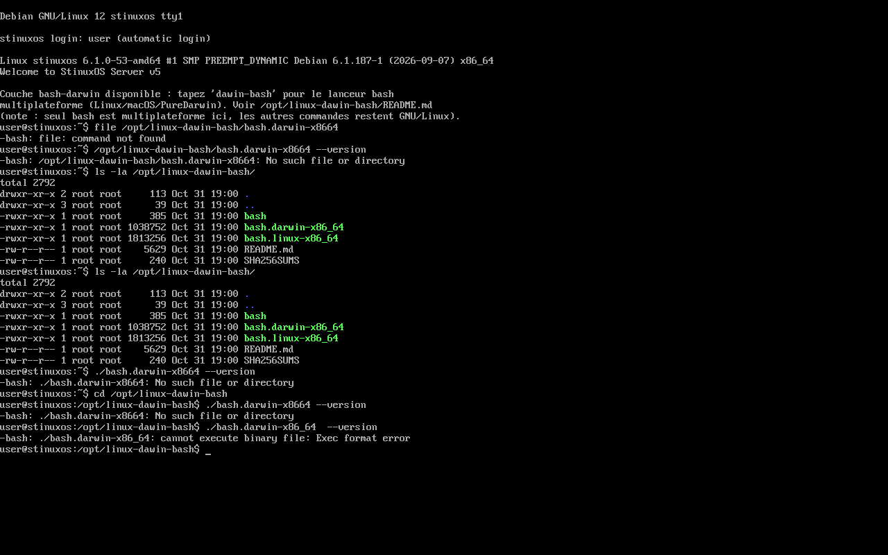

## Boot teste avec succes (QEMU, TCG, sans KVM)

### Login automatique + MOTD
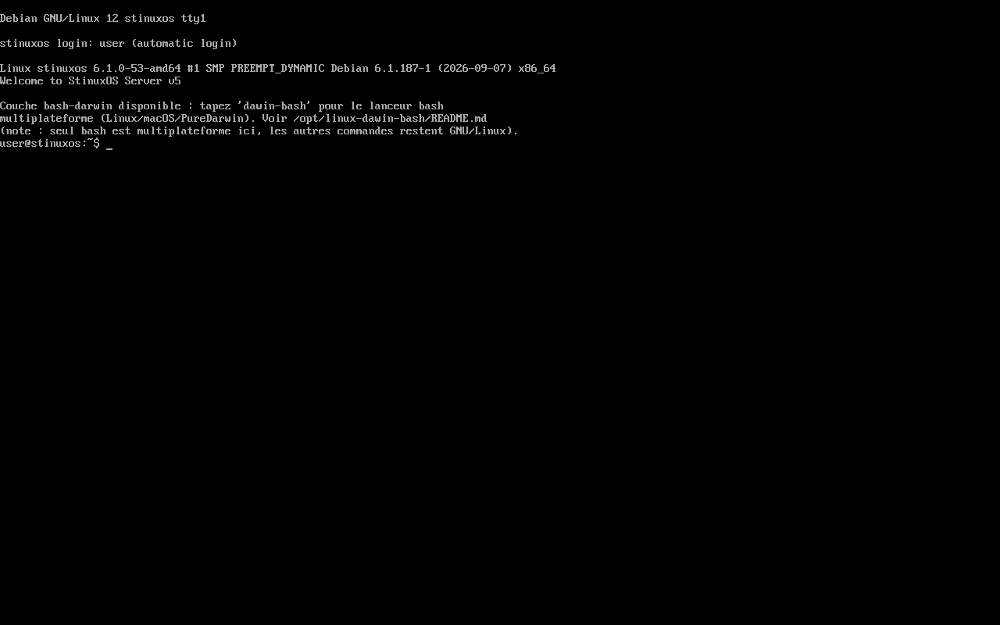

### dawin-bash fonctionnel


Non teste sur materiel reel.

## Commandes macOS/PureDarwin testees sur Stinux

Comparatif avec le tableau de [linux-dawin-bash](https://github.com/Leo-76/linux-dawin-bash) (macOS iMac / PureDarwin minimal) :

| Commande | macOS (iMac) | PureDarwin (minimal) | StinuxOS + dawin-bash |
|---|---|---|---|
| `uname -o` | echoue (BSD) | echoue (BSD) | marche (`GNU/Linux`) |
| `uname -sm` | `Darwin x86_64` | `Darwin x86_64` | `Linux x86_64` |
| `uname -a` / `-s` / `-r` | - | - | marche |
| `readlink -f /tmp` | `/private/tmp` | `/tmp` | `/tmp` |
| `file /bin/ls` | marche (Mach-O) | absent | absent |
| `sed --version` | echoue (BSD) | echoue | marche (`GNU sed 4.9`) |
| `ls --color /tmp` | marche | marche | marche |
| `df -h` | marche | marche | marche |
| `mount` | marche | marche | marche |
| `ls /` | marche | marche | marche |
| `sysctl kern.version` / `hw.*` / `machdep.cpu.*` | marche (BSD sysctl) | marche | absent (`command not found`) |
| `ifconfig` | marche (legacy) | marche | absent (remplace par `ip` sur Debian moderne) |
| `launchctl list` | marche (launchd) | marche | absent (equivalent Linux : `systemctl`) |
| `ps aux` | marche | marche | marche |
| `brew install ...` | marche (natif) | absent | absent |
| `port install ...` | marche (natif) | absent | absent |

A retenir : les commandes POSIX generiques (`uname`, `df`, `ls`, `ps`, `sed` GNU) marchent nativement sur Stinux. Les commandes **specifiques a Darwin/BSD** (`sysctl` syntaxe BSD, `launchctl`, `ifconfig` legacy, `brew`, `port`) n'existent pas sur Linux : `dawin-bash` choisit le bon binaire bash, il ne simule pas le reste de l'environnement Darwin.

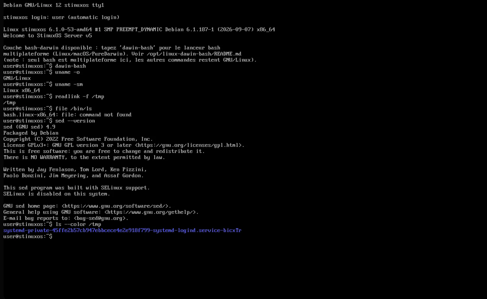
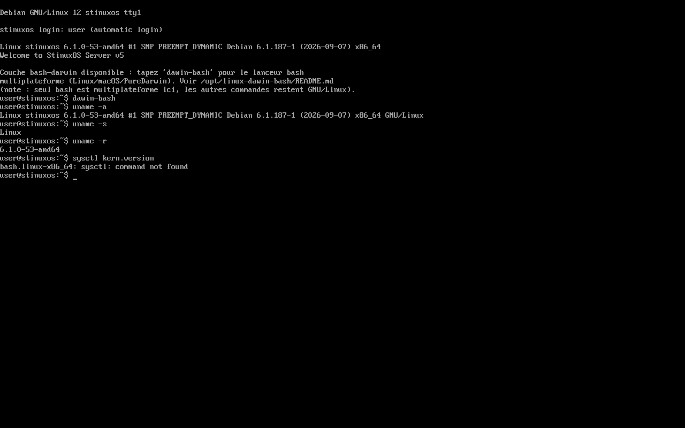

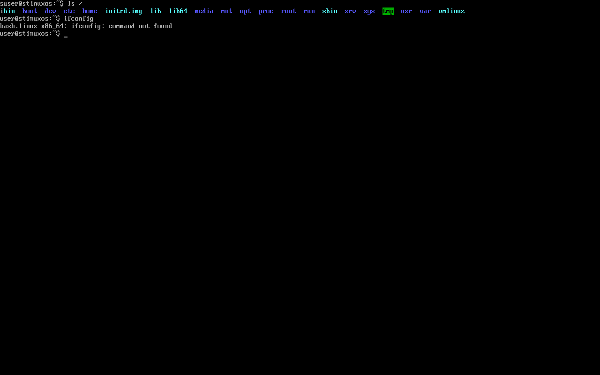

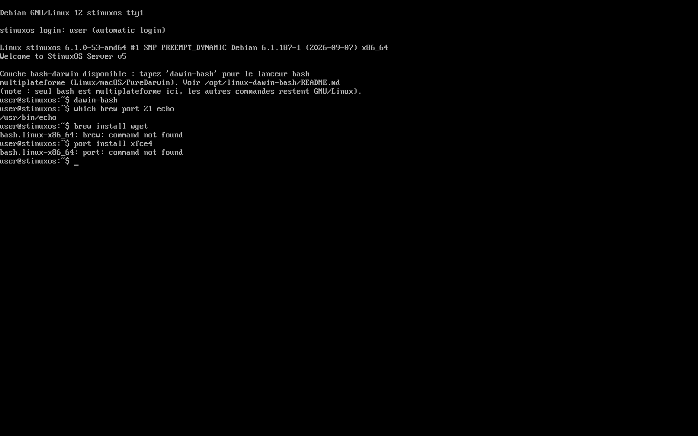


## Outils de developpement

Identique sous le bash systeme Linux et sous `dawin-bash` (meme PATH, `dawin-bash` ne fait que choisir le binaire bash) :

| Outil | Present | Version |
|---|---|---|
| `git` | oui | 2.39.5 |
| `python3` | oui | 3.11.2 |
| `curl` | oui | 7.88.1 (HTTPS/SSL complet) |
| `ssh` | oui | OpenSSH |
| `gcc` | non | absent |
| `make` | non | absent |
| `node` | non | absent |

Bon jeu de base pour scripter/cloner/deployer, mais pas de compilation (`gcc`/`make`) ni Node.js de base : a installer via `apt install build-essential nodejs` si besoin.

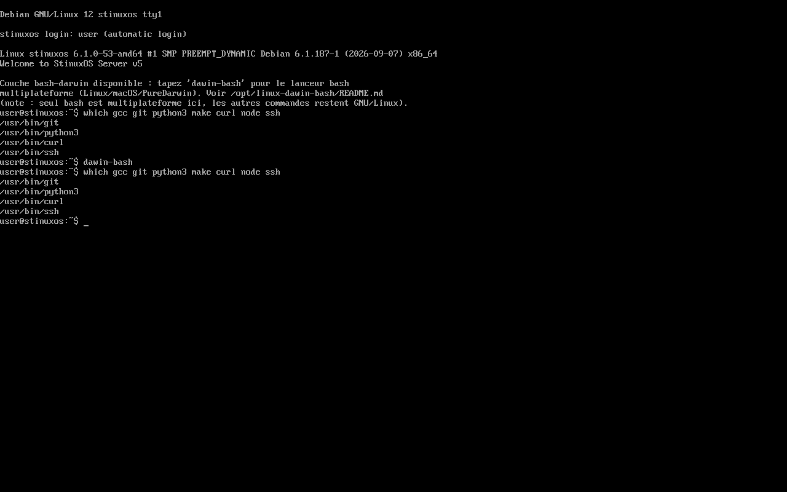


## Installation XFCE (apt install)

Stinux etant base sur Debian (bookworm), seule la commande Debian/APT du [tableau combine](https://github.com/Leo-76/BASH-BUILD-OSX) s'applique : `sudo apt install xfce4 xfce4-goodies`. Identique sous le bash systeme et sous `dawin-bash`.

- `sudo apt update` : echoue dans mon environnement de test (DNS bloque par le proxy du sandbox cloud, pas un defaut de Stinux)
- `sudo apt install -s xfce4 xfce4-goodies` (simulation) : **reussit completement**, resout tous les paquets XFCE (~1000+) grace au cache embarque dans l'ISO, meme hors ligne
- `sudo apt install -y xfce4` (installation reelle) : la resolution de paquets marche, mais le telechargement echoue faute de reseau sortant depuis mon environnement (`Could not resolve 'deb.debian.org'`) — fonctionnerait avec un acces internet normal

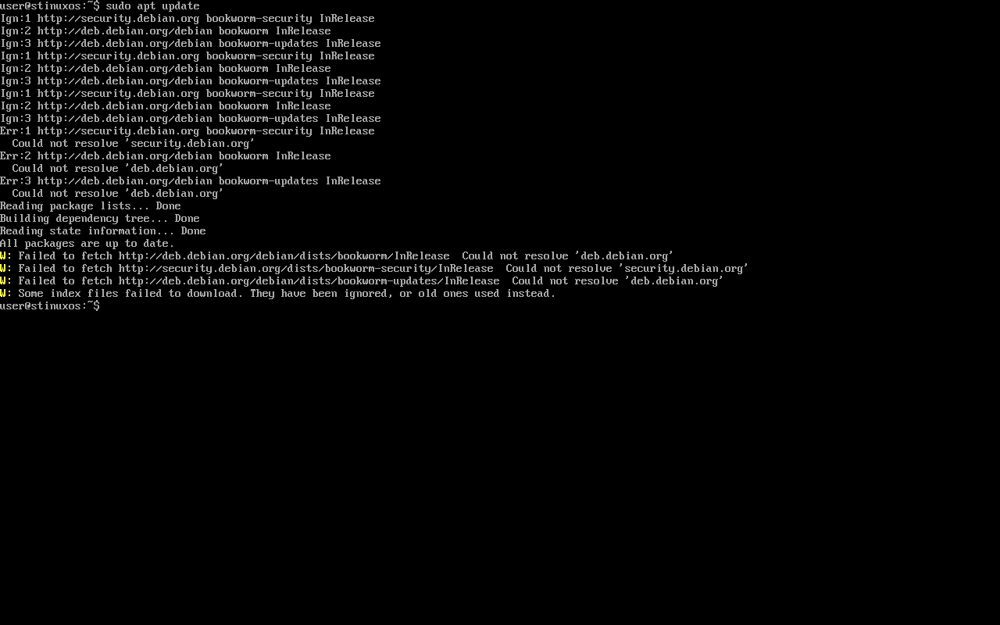
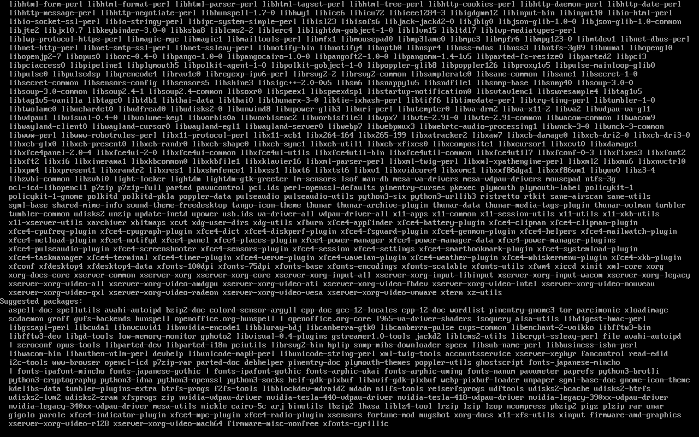
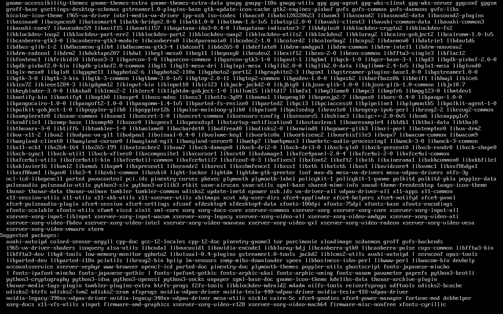
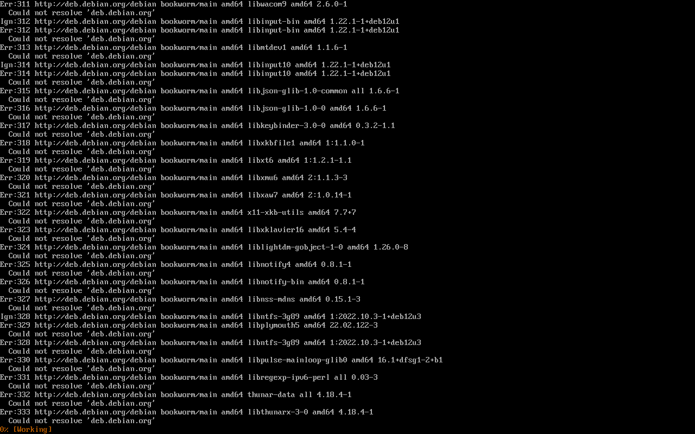

### Autres gestionnaires de paquets (pacman, zypper, apk, dnf...)

Absents, logiquement : ce sont des gestionnaires d'autres distributions (Arch/Manjaro, openSUSE, Alpine, Fedora/RHEL), pas de Debian.

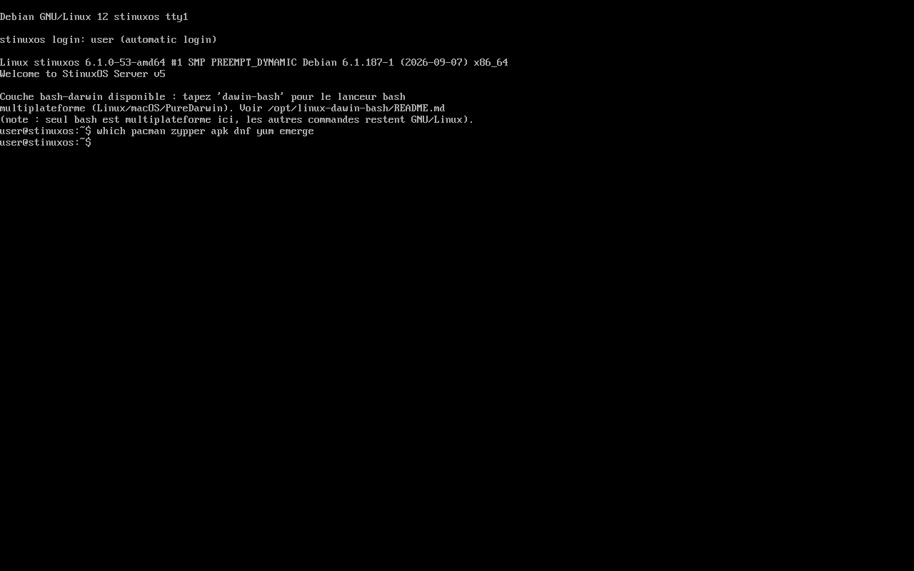

## Telechargement

Voir la [release](../../releases/latest) pour l'image ISO complete.

## Verification

```sh
sha256sum -c SHA256SUMS
```
