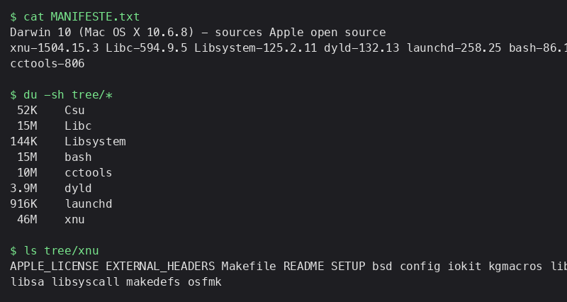

# Darwin 10 (Snow Leopard) : sources assemblées

Sources Apple open source de Mac OS X 10.6.8, versions dans [`MANIFESTE.txt`](MANIFESTE.txt) :
xnu-1504.15.3, Libc-594.9.5, Libsystem-125.2.11, dyld-132.13, launchd-258.25, bash-86.1, Csu-79, cctools-806.

```sh
sh fetch-darwin10.sh        # crée ./tree (~90 Mo)
```



## État réel

- Assemblage du dossier : **fait** (tous les tags téléchargés et vérifiés).
- Compilation : **pas faite**. xnu 10.6 ne se compile pas avec le clang de macOS Sequoia (outillage d'époque nécessaire).
- Image bootable / boot QEMU : **aucun**, donc pas de capture de boot.
- AppKit, CoreGraphics et WindowServer ne sont pas dans les sources publiées par Apple.

Les sources sont sous licence Apple (APSL) et ne sont pas incluses dans ce dépôt, seulement téléchargées par le script.
